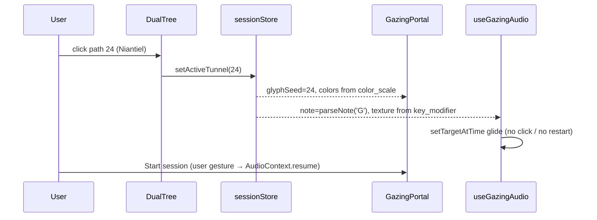

# GnosticOS — Architecture & Delivery Blueprint

> The Living Grimoire & Nightside Operating System
> Stack: **Tauri v2 (Rust)** · **React 19 + TypeScript + Vite** · **Tailwind CSS v4** · **Three.js / R3F** · **Web Audio** · **SQLCipher**

---

## 1. Repository Layout

```
GnosticOs/
├─ db/
│  ├─ schema.sql                 # Local vault (SQLite/SQLCipher) + seeds
│  └─ server_sync.pg.sql         # Zero-knowledge Magus sync (Postgres)
├─ src-tauri/                    # Rust core (Week 1)
│  ├─ src/
│  │  ├─ main.rs
│  │  ├─ vault/                  # rusqlite + bundled-sqlcipher, migrations
│  │  ├─ crypto/                 # argon2, aes-gcm, zeroize
│  │  ├─ ephemeris/              # optional native port of astro calcs
│  │  └─ stt/                    # whisper-rs local dictation (desktop)
│  └─ tauri.conf.json
├─ src/
│  ├─ app/                       # shell, routing, providers
│  ├─ features/
│  │  ├─ gazing/                 # GazingCircleCanvas.tsx, shaders.ts  ✅
│  │  ├─ audio/                  # useGazingAudio.ts  ✅, EnnLooper
│  │  ├─ tablets/                # gematria.ts  ✅, TabletGrid
│  │  ├─ tree/                   # Dual Tree (Day/Nightside)
│  │  ├─ journal/                # editor, ephemeris snapshot, dictation
│  │  ├─ crucible/               # 11 Points of Power
│  │  ├─ servitors/
│  │  └─ grimoire/               # entity browser
│  ├─ platform/                  # Tauri ↔ Web adapters (vault, stt, notifications)
│  ├─ lib/                       # ephemeris.ts, crypto.ts (WebCrypto), uuidv7
│  └─ styles/index.css           # Tailwind v4 @theme tokens
└─ docs/ARCHITECTURE.md
```

**Platform adapter rule:** feature code never imports `@tauri-apps/*` directly. It goes through `src/platform/*` interfaces, which have a Tauri implementation (desktop) and a Web implementation (PWA: OPFS + `wa-sqlite` + WebCrypto).

---

## 2. Component Hierarchy

```
<App>
├─ <VaultGate>                         # passphrase → Argon2id → unlock; nothing renders before this
│  └─ <EntitlementProvider tier="adept|magus">
│     └─ <SessionProvider>             # active tunnel, breath pattern, audio graph (shared by all views)
│        └─ <DesktopSanctum>           # main shell
│           ├─ <SanctumSidebar>
│           │  ├─ <EphemerisBadge/>    # live moon phase %, current planetary hour, countdown
│           │  ├─ <NavAltar/>          # Portal · Tree · Journal · Tablets · Crucible · Servitors · Grimoire
│           │  └─ <TierSeal/>
│           ├─ <Routes>
│           │  ├─ /portal  <GazingPortal>
│           │  │   ├─ <GazingCircleCanvas/>        # full-bleed WebGL
│           │  │   ├─ <PresetRail>                 # Ouroboros · Algol Star · Adversary Circle · 22 Sentinels · Black Mirror
│           │  │   ├─ <BreathCue/>                 # "Inhale / Hold / Exhale" from sampleBreath()
│           │  │   ├─ <SonicConsole>               # useGazingAudio: key, beat Hz, carrier, texture, volume
│           │  │   │   └─ <EnnLooper/>             # AudioBufferSourceNode loop, crossfaded
│           │  │   ├─ <StrobeConsentDialog/>       # photosensitivity gate
│           │  │   ├─ <TrancePosture timer/>       # Death Posture / Creative Vertigo session timer
│           │  │   └─ <QuickDictate/>              # hands-free → journal draft
│           │  ├─ /tree   <DualTree>
│           │  │   ├─ <TreeToggle day|night/>      # animated flip through Daath
│           │  │   ├─ <SephirothLayer/>            # 10 + Daath nodes → Nine Divinities
│           │  │   ├─ <TunnelsLayer/>              # 22 paths → tunnel cards
│           │  │   ├─ <DaathPylon/>                # Abyss crossing; links to Lucifuge Rofocale
│           │  │   └─ <TunnelDrawer>               # sentinel, gematria, Atu, key, “Open in Portal”
│           │  ├─ /journal <AlchemicalJournal>
│           │  │   ├─ <EntryList virtualized/>
│           │  │   ├─ <EntryEditor>
│           │  │   │   ├─ <EphemerisSnapshot/>     # frozen at ritual_at + GPS
│           │  │   │   ├─ <StateSliders pre/post/> <ResonanceDial/>
│           │  │   │   ├─ <OfferingsPicker/> <EntityPresencePicker/>
│           │  │   │   └─ <DictationButton/>
│           │  │   └─ <PatternInsights/>           # on-device analytics (Magus)
│           │  ├─ /tablets <TabletForge>
│           │  │   ├─ <IntentInput/> <CipherSelect/>
│           │  │   ├─ <ReductionChain/>            # 1054 → 10 → 1  ⇒ Kether / Satan
│           │  │   ├─ <TabletGrid9x9/>             # SVG, quadrant tint, animated sigil path
│           │  │   └─ <ExportSigil svg|png/>
│           │  ├─ /crucible <PowerCrucible>       # 11 points, 21–30 day cycles, streak heatmap
│           │  ├─ /servitors <ServitorRegistry>   # feeding RRULE reminders, dissolution countdown
│           │  └─ /grimoire <GrimoireBrowser>     # Divinities, Dukanté Families, 72 Goetia, Sentinels, Azhdeha
│           └─ <CommandPalette/>                # Ctrl+K: "open tunnel 24", "new entry", "lock vault"
```

**State:** Zustand stores per feature (`sessionStore`, `journalStore`, …). TanStack Query wraps vault IPC calls. The audio graph and WebGL context sit in `SessionProvider` so moving between views never cuts the drone.

---

## 3. Data Flow: Opening a Tunnel



---

## 4. Security Model

| Layer | Mechanism | Notes |
|---|---|---|
| KEK | Argon2id(passphrase, salt; m=64 MiB, t=3, p=1) | Rust `argon2`; Web: `hash-wasm` |
| DB at rest | SQLCipher 4 (`rusqlite` `bundled-sqlcipher`) | `tauri-plugin-sql` does **not** support SQLCipher, so the vault uses its own Rust commands |
| Payloads | AES-256-GCM, random 96-bit nonce, AAD = `id‖ritual_at‖aad_version` | AAD stops ciphertext from being swapped between rows |
| Sync | Whole rows sealed → `sync_objects` | Server sees only sizes and timestamps |
| Memory | `zeroize` on key drop; auto-lock after idle | Keys never cross IPC. The webview gets plaintext only for rows it renders |
| Recovery | 24-word recovery key wraps the DEK too | No server-side reset is possible by design. Tell users this clearly |

**Three design conflicts to fix before launch:**

1. **"AI pattern analysis" vs. zero-knowledge.** A server can't analyse what it can't read. Run the analysis **on the device**: grouped stats (mean resonance by `moon_phase × planetary_hour`, with a Bayesian shrinkage prior for small samples). Gate the feature by tier. Any cloud LLM summary must be an explicit opt-in that sends data out per request.
2. **Speech-to-text.** The Web Speech API sends audio to Google, and it doesn't work reliably in WebView2 or WebKitGTK. Desktop should use **local `whisper.cpp` (whisper-rs, `base.en`/`small` model)**. The PWA can use Web Speech only behind a privacy warning.
3. **Client-side paywalls can be bypassed.** Ship Magus presets and codices as **server-delivered encrypted content packs**, unlocked by a signed entitlement token (Ed25519, checked in Rust). Don't rely on a `tier` flag in the JS bundle.

---

## 5. Ephemeris Engine (`src/lib/ephemeris.ts`)

- **Library:** `astronomy-engine` (MIT, pure JS, about 1 arcminute accuracy). It covers Moon phase angle, illumination fraction, and sunrise/sunset for any lat/lon.
- **Moon phase:** elongation 0–360° split into 8 buckets of 45°, centred on 0/90/180/270.
- **Planetary hours:** Day hours = (sunset − sunrise)/12. Night hours = (next sunrise − sunset)/12. The first hour belongs to the day ruler (Sun→Sunday … Saturn→Saturday). After that, follow the Chaldean order: Saturn → Jupiter → Mars → Sun → Venus → Mercury → Moon. The magical day starts at **sunrise**, not midnight.
- **Edge case:** polar day/night (no sunrise) falls back to equal hours from local midnight, and the UI flags it.
- **Snapshot** values are written into `journal_entries` at save time, so past entries never shift when the ephemeris changes.

---

## 6. Safety & Accessibility (non-negotiable)

- **Strobe:** off by default. It needs a consent dialog, uses sine modulation only, depth ≤ 0.35, and ≤ 12 Hz. It is forced off under `prefers-reduced-motion`. These limits are already enforced in `GazingCircleCanvas`.
- **Session guardrails:** default trance timer is 20 min with a gentle audio fade-out. A "grounding" exit is always one keypress away (Esc): it fades audio, brightens the screen, and stops rotation.
- **Binaural audio:** first-run notice that headphones are needed, volume capped by default, beat clamped to 40 Hz.

---

## 7. Four-Week MVP Roadmap

> Scope note: a credible MVP in 4 weeks needs **E2EE cloud sync and payments pushed to Week 5+**. The MVP ships local-first, fully encrypted, with the entitlement layer stubbed.

### Week 1 — Foundation & Vault
| Day | Deliverable |
|---|---|
| 1 | `npm create tauri-app` (React-TS, Vite), Tailwind v4 `@theme` tokens (obsidian / ember / violet palette, Cinzel + Inter), ESLint, Vitest, Playwright |
| 2 | Rust vault: `rusqlite` + SQLCipher, migration runner, `db/schema.sql` v1 + seeds |
| 3 | Crypto: Argon2id KEK, DEK wrap/unwrap, AES-GCM seal/open commands, `zeroize`; `VaultGate` unlock UI |
| 4 | Platform adapter interfaces + Web impl skeleton (OPFS + wa-sqlite) |
| 5 | `DesktopSanctum` shell, sidebar, routing, command palette. **Exit:** encrypted vault opens, seeds visible |

### Week 2 — Gazing Portal & Sonic Engine
| Day | Deliverable |
|---|---|
| 1–2 | `GazingCircleCanvas` integration, preset system (uniform bundles), `BreathCue` |
| 3 | `useGazingAudio` + `SonicConsole`; tunnel → note/texture mapping |
| 4 | `EnnLooper` (decode → loop with 50 ms crossfade); strobe consent and session guardrails |
| 5 | Ouroboros and Sentinel presets as extra shader passes; perf pass (60 fps at 1080p on integrated GPU; DPR clamp). **Exit:** full audio-visual session |

### Week 3 — Dual Tree, Grimoire & Tablet Forge
| Day | Deliverable |
|---|---|
| 1–2 | `DualTree` SVG (Day/Night flip through Daath), `TunnelDrawer`, "Open in Portal" |
| 3 | `GrimoireBrowser` (Divinities, Azhdeha, Sentinels; Goetia/Dukanté via content pack) |
| 4 | `TabletForge` on `gematria.ts`; `TabletGrid9x9` animated sigil path; SVG export |
| 5 | **Content task:** finish the Connolly cipher F–Z from the source and add golden tests. **Exit:** tablet saved to vault |

### Week 4 — Journal, Crucible, Servitors & Release
| Day | Deliverable |
|---|---|
| 1 | `ephemeris.ts` + unit tests against published tables (moon phase, planetary hours for 3 latitudes) |
| 2 | `AlchemicalJournal` editor, sealed save, offerings/presence pickers |
| 3 | Local whisper dictation (desktop); `PowerCrucible` with streak heatmap |
| 4 | `ServitorRegistry` with RRULE reminders (Tauri notifications); on-device `PatternInsights` v0 |
| 5 | Signed installers (Windows MSIX/NSIS, macOS notarized, AppImage), PWA manifest + SW, threat-model review. **Exit:** MVP |

### Week 5+ (post-MVP)
Zero-knowledge sync (OPAQUE auth, `sync_objects` pull cursor, last-writer-wins plus a conflict UI), Paddle/Stripe checkout, signed entitlement tokens, encrypted content packs, mobile layout.

---

## 8. Open Content Questions

1. **Connolly cipher F–Z:** must come from the source text. The engine refuses to run without it.
2. **Tunnels 15 and 28:** the spec pairs He with Aries + The Star, and Tzaddi with Aquarius + The Emperor. That mixes Golden-Dawn sign placement with Crowley's swapped Atus. Check against *Nightside of Eden*.
3. **Licensing:** 11 Points of Power text, Enn recordings, Goetic sigils, and Grant's sentinel sigils. Use public-domain sources (Goetia) or get licences. Seed them through content packs, not the repo.
